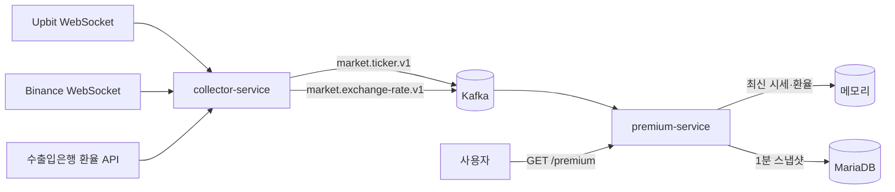

# coin-premium

멀티 거래소 실시간 시세를 수집해 **김치프리미엄**을 계산·제공·기록하는 MSA 서비스입니다.

> 국내 거래소(Upbit) 원화 가격과 해외 거래소(Binance) USDT 가격, 공식 환율(한국수출입은행)을 실시간으로 모아
> `김프(%) = (국내 가격 ÷ (해외 가격 × 환율) − 1) × 100` 을 계산합니다.

## 아키텍처



- 서비스 간 통신은 Kafka 비동기가 기본이며, 서비스끼리 직접 호출하지 않습니다.
- 서비스 내부는 헥사고날(포트·어댑터) 구조이며, ArchUnit 테스트로 의존 규칙을 강제합니다.
- 자세한 내용: [아키텍처 개요](docs/architecture/overview.md), [이벤트 명세](docs/events.md)

## 기술 스택

| 영역 | 사용 중 | 도입 예정 |
| --- | --- | --- |
| 언어·프레임워크 | Java 21 (Virtual Threads), Spring Boot 4.1 | Kotlin (collector 확장) |
| 빌드 | Gradle 8.14 (Kotlin DSL, Version Catalog, 데몬 JVM 21 고정) | 컨벤션 플러그인 |
| 메시징 | Kafka 4.1 (KRaft) | Kafka Streams, Outbox |
| 데이터 | MariaDB 11.8, jOOQ 3.21, Flyway | Redis |
| 수집 | JDK HttpClient WebSocket·REST | 데이터 공백 REST 보정 |
| 안정성 | 자동 재연결(백오프+지터), 좀비 연결 감지, 재시도 분류 | Resilience4j, Toxiproxy |
| 테스트 | JUnit 5, Testcontainers 2, ArchUnit | 장애 주입 테스트 |
| 인프라 | Docker Compose, kafbat UI | K8s(kind), ArgoCD, GitHub Actions, Terraform + AWS |
| 관측 | - | OpenTelemetry, Grafana |

## 로컬 실행

### 0. 준비물
- JDK 21 (JAVA_HOME이 다른 버전이어도 Gradle은 21로 실행됨: `gradle/gradle-daemon-jvm.properties`)
- Docker (+ Docker Compose 플러그인)

### 1. 환경 변수
```bash
cp .env.example .env
# .env에 DB 계정·비밀번호, 수출입은행 인증키(KOREAEXIM_API_KEY) 입력
```
`.env`는 Git에 올라가지 않습니다. PC마다 따로 만들며, 외부 API 키는 개발자별로 발급받습니다.

### 2. 인프라 (MariaDB, Kafka, kafbat UI)
```bash
docker compose up -d
docker compose ps   # 모두 healthy / Up 확인
```

| 서비스 | 로컬 주소 (127.0.0.1에만 바인딩) |
| --- | --- |
| MariaDB | localhost:3307 |
| Kafka | localhost:19092 |
| kafbat UI | http://localhost:8089 |

### 3. 서비스 실행 (collector 먼저)
```bash
./gradlew :services:collector-service:bootRun
./gradlew :services:premium-service:bootRun
```

### 4. 확인
```bash
curl -s "localhost:8081/premium?symbol=BTC"
```
- 김프 이력은 `premium_snapshot` 테이블에 매 분 저장됩니다.
- 기동 직후 데이터가 모이기 전에는 503 + `Retry-After`가 응답됩니다.

### 테스트
```bash
./gradlew test   # Docker만 켜져 있으면 Testcontainers가 MariaDB·Kafka를 자동으로 띄움
```

## 새 개발 환경 세팅 (WSL 기준)

| 단계 | 명령 / 내용 |
| --- | --- |
| Docker Engine 설치 | Docker 공식 문서 "Install Docker Engine on Ubuntu" → `sudo usermod -aG docker $USER` 후 WSL 재시작 |
| Docker 서비스 시작 | `sudo service docker start` (WSL 재시작 시 필요할 수 있음) |
| 저장소 위치 | WSL 리눅스 파일 시스템(`~/...`)에 clone (`/mnt/c`는 느림) |
| GitHub 인증 | `gh auth login` (HTTPS, 브라우저 인증) |
| 커밋 작성자 | 회사 계정과 섞이지 않게 저장소별 `git config user.email` 설정 |
| 환경 변수 | `cp .env.example .env` 후 값 입력 |

## 모듈 구조

```
coin-premium/
├── common/event-contract/      # 서비스 간 이벤트 계약 (순수 Java)
├── services/collector-service/ # 거래소·환율 수집 → Kafka 발행
├── services/premium-service/   # 김프 계산·조회 API·1분 스냅샷 저장
└── docs/                       # ADR, 트러블슈팅, 아키텍처
```

## 진행 현황

- [x] 멀티 모듈 빌드, 로컬 인프라(Docker Compose)
- [x] 이벤트 계약 (TickerEvent, ExchangeRateEvent)
- [x] Upbit·Binance WebSocket 실시간 수집, 자동 재연결, 좀비 연결 감지
- [x] 수출입은행 환율 수집 스케줄러 (주말·연휴 대응, 재시도)
- [x] Kafka 발행·구독
- [x] premium-service: 김프 계산 도메인, 조회 API(ProblemDetail), 1분 스냅샷 저장(Flyway + jOOQ)
- [x] Testcontainers 통합 테스트, ArchUnit 구조 규칙
- [ ] RESTful API 정리 (`/v1/coins/{symbol}/premium`), 김프 추이 API
- [ ] Mintlify API 문서, PR AI 코드 리뷰
- [ ] 2단계 안정성 (Resilience4j, Redis, 데이터 공백 보정, Feature Flag)

## 문서

- [ADR (기술 결정 기록)](docs/adr/README.md)
- [트러블슈팅](docs/troubleshooting/README.md)
- [아키텍처 개요](docs/architecture/overview.md)
- [이벤트 명세](docs/events.md)
