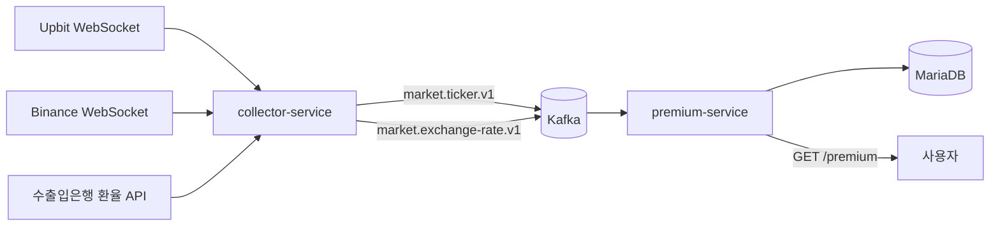

# coin-premium

멀티 거래소 실시간 시세를 수집해 **김치프리미엄**을 계산·제공·알림하는 MSA 서비스입니다.

> 국내 거래소(Upbit) 원화 가격과 해외 거래소(Binance) USDT 가격, 공식 환율(한국수출입은행)을 실시간으로 모아
> `김프(%) = (국내 가격 ÷ (해외 가격 × 환율) − 1) × 100` 을 계산합니다.

## 아키텍처



- 서비스 간 통신은 Kafka 비동기가 기본이며, 서비스끼리 직접 호출하지 않습니다.
- 서비스 내부는 헥사고날(포트·어댑터) 구조입니다.
- 자세한 내용: [아키텍처 개요](docs/architecture/overview.md), [이벤트 명세](docs/events.md)

## 기술 스택

| 영역 | 사용 중 | 도입 예정 |
| --- | --- | --- |
| 언어·프레임워크 | Java 21 (Virtual Threads), Spring Boot 4.1 | Kotlin (collector 확장) |
| 빌드 | Gradle (Kotlin DSL, Version Catalog) | 컨벤션 플러그인 |
| 메시징 | Kafka 4.1 (KRaft) | Kafka Streams, Outbox |
| 데이터 | MariaDB 11.8 | jOOQ, Flyway, Redis |
| 수집 | JDK HttpClient WebSocket·REST | 데이터 공백 REST 보정 |
| 안정성 | 자동 재연결(백오프+지터), 좀비 연결 감지, 재시도 분류 | Resilience4j, Toxiproxy |
| 인프라 | Docker Compose, kafbat UI | K8s(kind), ArgoCD, GitHub Actions |
| 관측 | - | OpenTelemetry, Grafana |

## 로컬 실행

### 1. 환경 변수
```bash
cp .env.example .env
# .env에 DB 비밀번호, 수출입은행 인증키(KOREAEXIM_API_KEY) 입력
```

### 2. 인프라 (MariaDB, Kafka, kafbat UI)
```bash
docker compose up -d
docker compose ps   # 모두 healthy / Up 확인
```

| 서비스 | 로컬 주소 |
| --- | --- |
| MariaDB | localhost:3307 |
| Kafka | localhost:19092 |
| kafbat UI | http://localhost:8089 |

### 3. 수집 서비스
```bash
./gradlew :services:collector-service:bootRun
```
kafbat UI에서 `market.ticker.v1`, `market.exchange-rate.v1` 토픽 메시지를 확인할 수 있습니다.

## 모듈 구조

```
coin-premium/
├── common/event-contract/      # 서비스 간 이벤트 계약 (순수 Java)
├── services/collector-service/ # 거래소·환율 수집 → Kafka 발행
├── services/premium-service/   # (진행 예정) 김프 계산·조회 API
└── docs/                       # ADR, 트러블슈팅, 아키텍처
```

## 진행 현황

- [x] 멀티 모듈 빌드, 로컬 인프라(Docker Compose)
- [x] 이벤트 계약 (TickerEvent, ExchangeRateEvent)
- [x] Upbit·Binance WebSocket 실시간 수집, 자동 재연결, 좀비 연결 감지
- [x] 수출입은행 환율 수집 스케줄러 (주말·연휴 대응, 재시도)
- [x] Kafka 발행
- [ ] premium-service: 김프 계산·조회 API
- [ ] 2단계 안정성 (Resilience4j, Redis, 데이터 공백 보정)

## 문서

- [ADR (기술 결정 기록)](docs/adr/README.md)
- [트러블슈팅](docs/troubleshooting/README.md)
- [아키텍처 개요](docs/architecture/overview.md)
- [이벤트 명세](docs/events.md)
