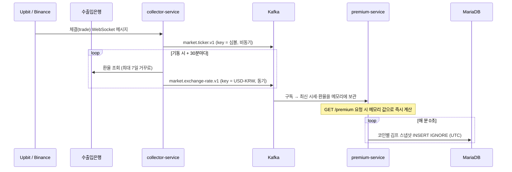

# 아키텍처 개요

## 서비스 구성

| 서비스 | 역할 | 상태 |
| --- | --- | --- |
| collector-service | 거래소 WebSocket·환율 REST 수집 → Kafka 발행 | 1단계 완료 |
| premium-service | Kafka 구독, 김프 계산, 조회 API, 1분 스냅샷 저장 | 1단계 완료 |
| event-contract | 서비스 간 이벤트 정의 (공통 모듈) | 사용 중 |
| market-service | 캔들 집계, 실시간 캔들 | 3단계 |
| gateway | 외부 요청 진입점 | 2~3단계 |

## 데이터 흐름



## premium-service 내부 구조 (헥사고날)

```
premium/
├── domain/              KimchiPremium, PriceQuote, FxRate (순수 Java)
├── application/
│   ├── port/out/        MarketDataRepository, PremiumSnapshotRepository
│   ├── service/         PremiumQueryService, PremiumSnapshotService
│   └── exception/       UnsupportedSymbolException(404), MarketDataNotReadyException(503)
├── adapter/
│   ├── in/kafka/        MarketDataKafkaListener
│   ├── in/web/          PremiumController, PremiumExceptionHandler
│   ├── in/scheduler/    PremiumSnapshotScheduler
│   ├── out/memory/      InMemoryMarketDataRepository (ConcurrentHashMap)
│   └── out/persistence/ JooqPremiumSnapshotRepository
└── config/              PremiumProperties, ClockConfig
```

세 갈래 흐름은 서로 독립적이다.

1. Kafka → Listener → 메모리 저장소 (최신값 덮어쓰기)
2. API 요청 → PremiumQueryService → 김프 계산 → 응답 (저장하지 않음)
3. 매 분 → PremiumSnapshotService → 같은 PremiumQueryService로 계산 → DB 저장

조회 API와 스냅샷이 같은 서비스를 재사용하므로 두 값의 계산 규칙이 항상 같다.

## collector-service 내부 구조 (헥사고날)

```
collector/
├── application/
│   ├── port/out/      TickerPublisher, ExchangeRateFetcher, ExchangeRatePublisher
│   └── service/       ExchangeRateCollector
├── adapter/
│   ├── in/websocket/  ExchangeWebSocketClient (공통) ← Upbit, Binance
│   ├── in/scheduler/  ExchangeRateScheduler
│   ├── out/kafka/     KafkaTickerPublisher, KafkaExchangeRatePublisher
│   └── out/koreaexim/ KoreaEximClient
└── config/            ClockConfig
```

## 의존 규칙 (ArchUnit으로 강제)

| 규칙 | 대상 |
| --- | --- |
| domain은 Spring·jOOQ·Kafka·Jackson·contract에 의존하지 않는다 | premium |
| application은 adapter에 의존하지 않는다 (포트만 사용) | collector, premium |
| adapter.in은 adapter.out을 직접 사용하지 않는다 | collector, premium |

- 서비스끼리의 import 금지는 Gradle 모듈 의존성으로 컴파일 단계에서 강제된다.
- `event-contract`는 Spring 의존 없이 순수 Java로 유지한다.

## 로컬 인프라

| 구성 | 이미지 | 호스트 포트 | 비고 |
| --- | --- | --- | --- |
| MariaDB | mariadb:11.8 | 127.0.0.1:3307 | utf8mb4, UTC 타임존 |
| Kafka | apache/kafka:4.1.0 | 127.0.0.1:19092 | KRaft 단일 노드, 리스너 분리 (EXTERNAL / INTERNAL 29092 / CONTROLLER) |
| kafbat UI | ghcr.io/kafbat/kafka-ui:v1.3.0 | 127.0.0.1:8089 | INTERNAL 리스너로 접속 |

포트는 127.0.0.1에만 바인딩해 같은 네트워크의 다른 PC에서 접근할 수 없도록 한다.
