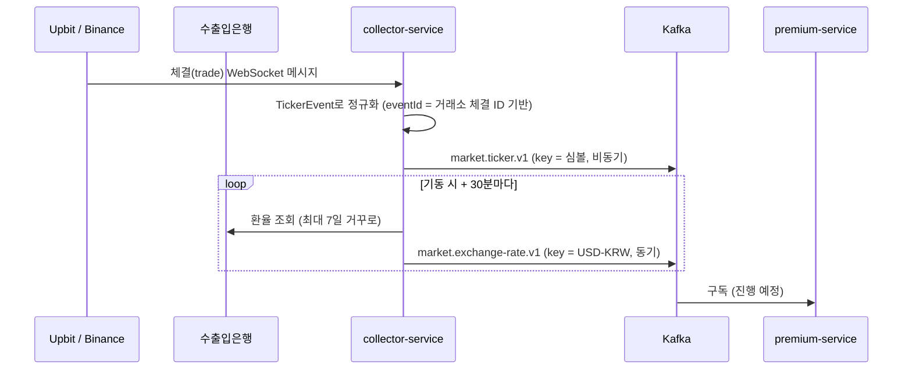

# 아키텍처 개요

## 서비스 구성

| 서비스 | 역할 | 상태 |
| --- | --- | --- |
| collector-service | 거래소 WebSocket·환율 REST 수집 → Kafka 발행 | 1단계 완료 |
| premium-service | Kafka 구독, 김프 계산, 조회 API, 이력 저장 | 진행 예정 |
| event-contract | 서비스 간 이벤트 정의 (공통 모듈) | 사용 중 |
| market-service | 캔들 집계, 실시간 캔들 | 3단계 |
| gateway | 외부 요청 진입점 | 2~3단계 |

## 데이터 흐름



## collector-service 내부 구조 (헥사고날)

```
collector/
├── application/
│   ├── port/out/      TickerPublisher, ExchangeRateFetcher, ExchangeRatePublisher
│   └── service/       ExchangeRateCollector (환율 수집 규칙)
├── adapter/
│   ├── in/websocket/  ExchangeWebSocketClient (공통) ← Upbit, Binance
│   ├── in/scheduler/  ExchangeRateScheduler
│   ├── out/kafka/     KafkaTickerPublisher, KafkaExchangeRatePublisher
│   └── out/koreaexim/ KoreaEximClient
└── config/            ClockConfig
```

- WebSocket 수신 코드는 `TickerPublisher` 포트만 의존한다. 로그 발행기 → Kafka 발행기로 교체할 때 수신 코드 변경이 없었다.
- 환율 수집 규칙(거꾸로 조회, 재시도, 중복 생략)은 서비스에 두어 Spring·HTTP 없이 단위 테스트한다.

## 의존 규칙

- 서비스는 `event-contract`만 의존한다. 서비스끼리 직접 import하지 않는다.
- `event-contract`는 Spring 의존 없이 순수 Java로 유지한다.
- 서비스 간 통신은 Kafka 비동기가 기본이다.
- (예정) 위 규칙은 ArchUnit 테스트로 강제한다.

## 로컬 인프라

| 구성 | 이미지 | 호스트 포트 | 비고 |
| --- | --- | --- | --- |
| MariaDB | mariadb:11.8 | 3307 | utf8mb4, UTC 타임존 |
| Kafka | apache/kafka:4.1.0 | 19092 | KRaft 단일 노드, 리스너 분리 (EXTERNAL / INTERNAL 29092 / CONTROLLER) |
| kafbat UI | ghcr.io/kafbat/kafka-ui:v1.3.0 | 8089 | INTERNAL 리스너로 접속 |
